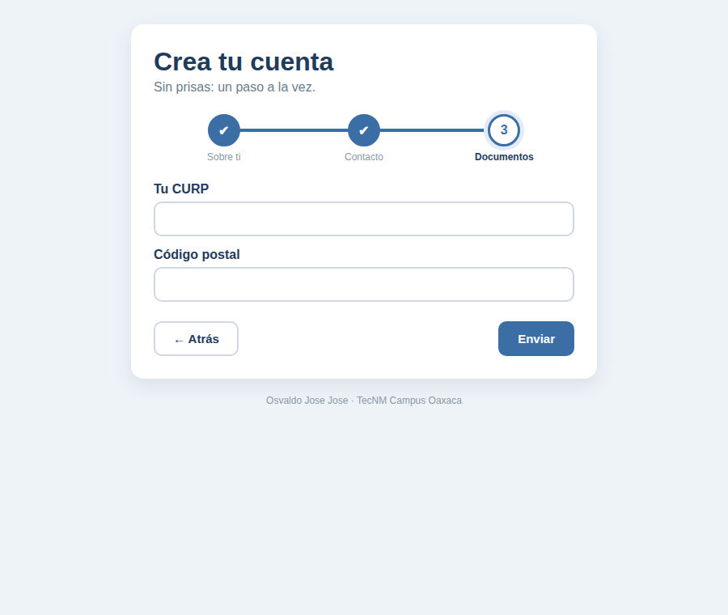
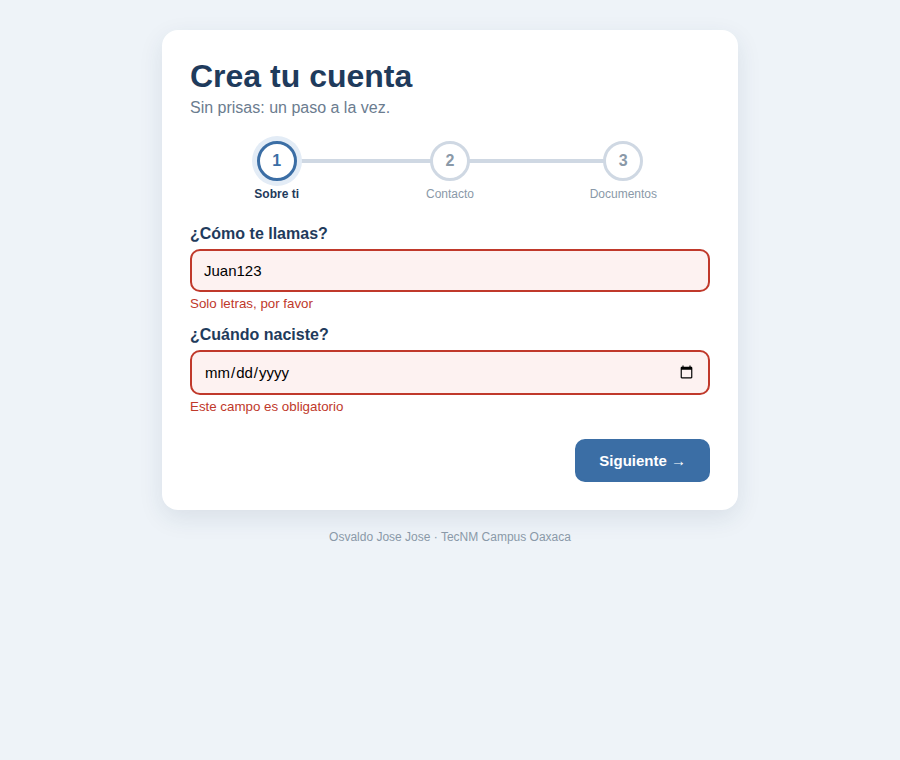
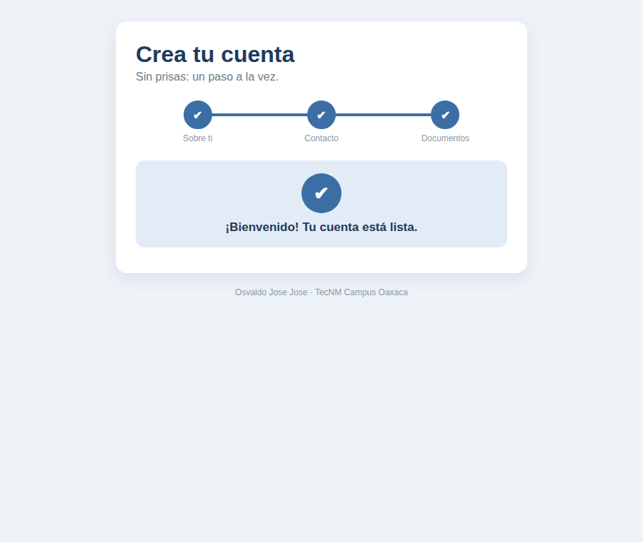

# PasosJS 🔵

**Un formulario largo, dividido en pasos cortos.**

🔗 **Pruébalo en vivo:** https://josejose7520-dev.github.io/pasosjs/
📁 **Código:** https://github.com/JoseJose7520-dev/pasosjs



---

## ¿Qué problema resuelve?

A nadie le gusta ver un formulario con diez campos de golpe. Da flojera, no sabes cuánto te falta y, si te equivocas, te enteras hasta el final.

**PasosJS** hace lo que haría una persona amable: te pide los datos **poco a poco**.

- Muestra **un paso a la vez**.
- Arriba ves **en qué paso vas** y cuáles ya terminaste (✔).
- **No te deja avanzar** si algo está mal, y te dice qué corregir.
- Al final te da las **gracias**.

Funciona con cualquier formulario, sin frameworks: solo un archivo CSS y uno JS.

---

## Instalación

Agrega el CSS dentro de `<head>`:

```html
<link rel="stylesheet" href="css/componente.css">
```

Y el JS antes de cerrar `</body>`:

```html
<script src="js/componente.js"></script>
```

---

## Uso

### 1. Separa tu formulario en `fieldset`

Cada `fieldset` es un paso. Lo que escribas en `data-paso` es el nombre que aparece debajo del círculo.

```html
<form id="registro" novalidate>
    <fieldset data-paso="Sobre ti">
        <label for="nombre">¿Cómo te llamas?</label>
        <input type="text" id="nombre" name="nombre" required>
    </fieldset>

    <fieldset data-paso="Contacto">
        <label for="correo">Tu correo</label>
        <input type="email" id="correo" name="correo" required>
    </fieldset>
</form>
```

### 2. Enciéndelo con una línea

```javascript
crearPasos("#registro");
```

Eso es todo. El componente dibuja los círculos, los botones y el mensaje final.

### 3. Personalízalo (opcional)

```javascript
crearPasos("#registro", {
    textoSiguiente: "Continuar",
    textoEnviar: "Crear mi cuenta",
    mensajeFinal: "¡Bienvenido! Tu cuenta está lista.",
    alTerminar: function (datos) {
        console.log(datos);   // aquí podrías guardar los datos
    }
});
```

| Opción | Para qué sirve | Si no la pones |
|---|---|---|
| `textoSiguiente` | Texto del botón para avanzar | "Siguiente" |
| `textoEnviar` | Texto del botón en el último paso | "Enviar" |
| `mensajeFinal` | Mensaje al terminar | "¡Listo! Tus datos se enviaron." |
| `alTerminar` | Qué hacer con los datos al final | Solo los muestra en consola |

### 4. Revisar los datos antes de avanzar

- `required`: el campo no puede ir vacío.
- `data-validar`: el nombre de una función que revise el dato.
- `data-error`: el mensaje que verá la persona si el dato está mal.

```html
<input type="email" name="correo" required
       data-validar="validarCorreo"
       data-error="Ejemplo: nombre@correo.com">
```

Aquí uso mi librería **utileria.js** de la actividad anterior, cargada desde su CDN:

```html
<script src="https://cdn.jsdelivr.net/gh/JoseJose7520-dev/utileria@v1.1.1/js/utileria.min.js"></script>
```



---

## ¿Cómo funciona por dentro?

La idea es sencilla: el formulario completo siempre está ahí, pero el componente **esconde todos los pasos menos uno**.

```javascript
pasos.forEach(function (paso, i) {
    paso.hidden = i !== actual;   // escóndelo si no es el paso actual
});
```

Avanzar es solo sumar 1 a `actual` y volver a mostrar. Los círculos cambian de color porque el JavaScript les pone la clase `hecho`, y el CSS dice cómo se ve un paso hecho:

```css
.pasos-circulo.hecho span {
    background: var(--azul);
    color: white;
}
```
---

## Capturas de pantalla

| Si algo está mal | Avanzando | Al terminar |
|---|---|---|
|  |  |  |

**Consola** (F12): al terminar se muestran los datos enviados.


---

## Video

🎬 [Ver el video (1 minuto)](https://youtu.be/F7TmENSJRdY)

---

## Autor

**Osvaldo Jose Jose** · Ingeniería en Sistemas Computacionales · TecNM Oaxaca
